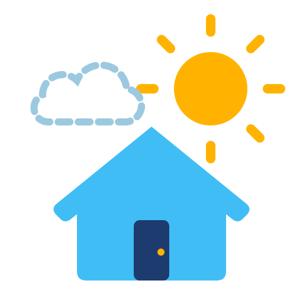
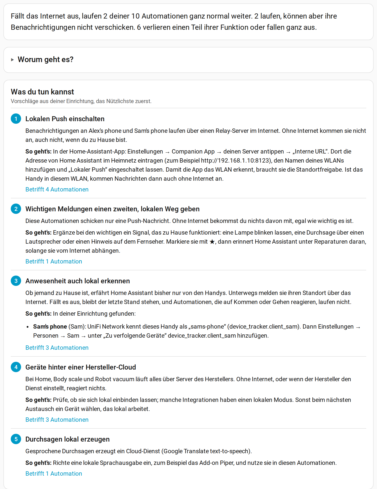
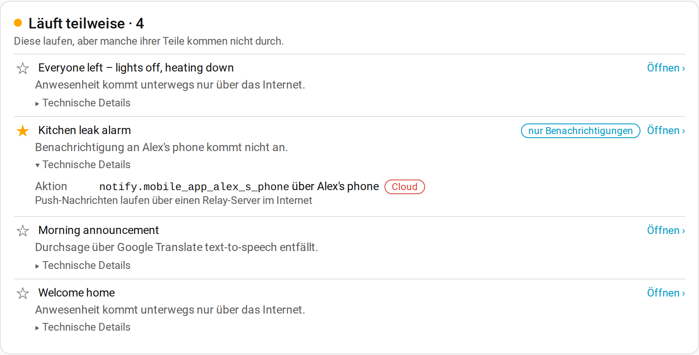

<p align="center"></p>

# Unclouded

[English](README.md) · **Deutsch**

<p align="center">
  
  
  <a href="LICENSE"></a>
  
</p>

Finde heraus, was in deinem Home Assistant noch läuft, wenn das Internet weg ist – und was
du tun kannst, damit das Wichtige weiter funktioniert.

**Neu hier?** Die [Anleitung](docs/anleitung.md) erklärt das Panel Schritt für Schritt und
wie Unclouded zu seinen Ergebnissen kommt.

<p align="center"><picture><source media="(prefers-color-scheme: dark)" srcset="docs/screenshots/overview-de-dark.png"></picture></p>

## Warum

Viele Geräte und Dienste in Home Assistant arbeiten über Server im Internet: die des
Herstellers, von Apple oder Google oder eines Cloud-Dienstes. Ist das Internet weg, hat der
Anbieter eine Störung oder schaltet er seinen Dienst ab, funktioniert auch zu Hause etwas
nicht mehr – oft etwas, womit man nicht rechnet. Ein Wasseralarm, der nur eine
Push-Nachricht schickt, bleibt ohne Internet stumm. „Alle weg“ löst nie aus, wenn die Handys
ihren Standort nicht melden können. Ein Sensor hinter einer Hersteller-Cloud hört einfach
auf.

Home Assistant zeigt bei jeder Integration, ob sie Internet braucht, aber nicht, was das für
deine Automationen bedeutet. Unclouded rechnet das für deine Einrichtung aus und sagt dir in
klaren Worten, was du ändern kannst.

## Funktionen

- **Ein Satz pro Automation:** ob sie weiterläuft, nur ihre Benachrichtigungen verliert oder
  Funktion verliert, und warum – zum Beispiel „Benachrichtigung an Alex's phone kommt nicht
  an“.
- **Vorschläge aus deiner Einrichtung:** Lokalen Push einschalten, wichtigen Meldungen einen
  zweiten, lokalen Weg geben, Anwesenheit zusätzlich über den Router erkennen (mit dem
  genauen Eintrag für jedes Handy), Geräte und Dienste aus der Cloud mit einem bekannten
  lokalen Weg, wo es einen gibt, Durchsagen, die auch offline gehen. Jeder Vorschlag verlinkt
  die Seite, auf der du ihn umsetzt.
- **Schaut tiefer als die Integrationsliste:** folgt Skripten, Szenen, Gruppen,
  Template-Sensoren und anderen Helfern bis zu ihren Quellen, Personen und Zonen bis zu den
  Handys und Benachrichtigungen bis zu ihrem Zustellweg.
- **Weiß, wo die Herstellerangabe nicht reicht:** Integrationen, die je nach Einrichtung
  lokal oder über die Cloud laufen, Handys, die zu Hause lokal und unterwegs über das
  Internet melden, Push-Nachrichten, die lokal aussehen, aber über einen Relay-Server laufen.
- **Wichtige Automationen:** mit einem Stern markieren, dann führt Home Assistant sie unter
  Reparaturen, solange sie vom Internet abhängen.
- **Bemerkt Änderungen:** Braucht eine Integration nach einem Update Internet, obwohl sie
  vorher ohne auskam, meldet das ein Reparaturhinweis.
- **Lücken füllst du:** Eine Integration, die nicht angibt, wie sie sich verbindet, kannst du
  selbst einstufen. Was Unclouded selbst ermittelt hat, lässt sich nicht überstimmen.
- **Sprachassistent:** prüft jede Assist-Pipeline Schritt für Schritt und nennt die
  Sprachsatelliten, die sie nutzen.
- **Werte, die ohne Internet ersetzt werden:** findet Templates, die einen Cloud-Wert mit
  Ersatzwert wie `float(10)` lesen, sodass die Automation still nach dem Ersatzwert entscheidet.
- **Echte Ausfälle:** ein Sensor zeigt, ob das Internet erreichbar ist. Nach einem Ausfall
  vergleicht Unclouded, was wirklich nicht erreichbar war, mit seiner Einschätzung.
- **Liest nur:** Unclouded ändert nichts an deiner Einrichtung. Die einzige Verbindung, die es
  selbst aufbaut, ist die Prüfung, ob das Internet erreichbar ist (siehe unten).

## So funktioniert es

1. Öffne **Unclouded** in der Seitenleiste. Die Übersicht oben zeigt, wie viele Automationen
   ohne Internet weiterlaufen und was mit den anderen passiert.
2. **Was du tun kannst** listet Vorschläge, das Nützlichste zuerst, jeweils mit Warum und
   So geht's.
3. Darunter steht jede Automation danach sortiert, was mit ihr passiert, mit einem Satz zur
   Begründung. **Technische Details** zeigt jeden Auslöser, jede Bedingung und jede Aktion,
   die Internet braucht, mit der Integration dahinter.

   <picture><source media="(prefers-color-scheme: dark)" srcset="docs/screenshots/automations-de-dark.png"></picture>

4. Markiere die Automationen, auf die es ankommt, mit ★. Home Assistant erinnert dann unter
   **Einstellungen → Reparaturen** daran, solange sie vom Internet abhängen.

## Installation

Unclouded braucht Home Assistant 2026.10 oder neuer.

**HACS:** In HACS das Menü → **Benutzerdefinierte Repositories** öffnen,
`https://github.com/Schnuecks/ha-unclouded` mit dem Typ **Integration** hinzufügen, dann
**Unclouded** installieren und Home Assistant neu starten.

**Von Hand:** `custom_components/unclouded` in den Ordner `custom_components` deiner Home
Assistant-Konfiguration kopieren und neu starten.

Danach die Integration unter **Einstellungen → Geräte & Dienste → Integration hinzufügen →
Unclouded** hinzufügen. Das Panel erscheint für Administratoren in der Seitenleiste.

## Gut zu wissen

- **Eine Einschätzung, kein Test:** Unclouded arbeitet mit dem, wie sich Integrationen
  verbinden, und trennt nicht das Internet. Eine Integration ohne Angabe gilt als unbekannt,
  bis du sie einstufst.
- **Templates in Aktionen:** Entity-IDs, die ein Template erst zur Laufzeit bildet, lassen
  sich nicht verfolgen und werden ausgelassen.
- **Benachrichtigungen:** Ist in der Companion App Lokaler Push eingeschaltet, kommen
  Nachrichten zu Hause auch ohne Internet an. Unclouded erkennt das bei Android an der
  Registrierung der App, bei iPhone und iPad am Push-Kanal, den die App zu Hause offen hält.
- **Internet-Prüfung:** Einmal pro Minute baut Unclouded eine Verbindung zu den öffentlichen
  DNS-Servern 1.1.1.1 und 9.9.9.9 auf Port 53 auf und schließt sie wieder; gesendet wird
  nichts. Erst wenn zweimal hintereinander keiner antwortet, gilt das Internet als weg.
- **Neustarts:** Was rund um einen Neustart von Home Assistant nicht erreichbar war, bleibt
  beim Vergleich mit echten Ausfällen außen vor.
- **Falsch eingestuft?** Bitte ein Issue mit der Integration und ihrer Einrichtung eröffnen,
  damit es für alle korrigiert wird; siehe [CONTRIBUTING](CONTRIBUTING.md).

## Entwicklung

```bash
python -m venv .venv && . .venv/bin/activate
pip install -r requirements-dev.txt
ruff check . && ruff format --check . && pytest
```

Siehe [CONTRIBUTING](CONTRIBUTING.md).

## Wie es entsteht

Unclouded entsteht mit Hilfe eines KI-Programmierassistenten. Ich lege Funktionen und
Verhalten fest, prüfe die Änderungen und teste sie in meinem eigenen Home Assistant.
Veröffentlicht wird nichts, was die automatischen Prüfungen nicht besteht: die Tests,
hassfest von Home Assistant und die HACS-Prüfung.

## Unterstützen

Unclouded ist kostenlos und bleibt es. Wenn es dir hilft, kannst du mir auf Ko-fi einen
Kaffee spendieren; das hält das Projekt am Laufen. Danke!

<p>
  <a href="https://ko-fi.com/schnuecks"></a>
</p>

## Rückmeldungen

Fehlerberichte und Ideen sind als
[GitHub-Issues](https://github.com/Schnuecks/ha-unclouded/issues) willkommen. Siehe auch
[CONTRIBUTING](CONTRIBUTING.md) und [SECURITY](SECURITY.md).

Was sich in jeder Version geändert hat, steht im [CHANGELOG](CHANGELOG.md).

**Was du erwarten kannst:** Unclouded ist ein Hobbyprojekt, das ich in meinem eigenen Home
Assistant nutze. Issues und Pull Requests schaue ich mir an, wenn ich Zeit habe, ohne
garantierte Antwortzeit.

## Lizenz

Copyright (c) 2026 Schnuecks. Veröffentlicht unter der [MIT-Lizenz](LICENSE).
