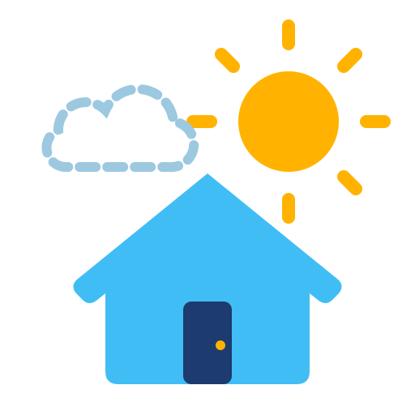
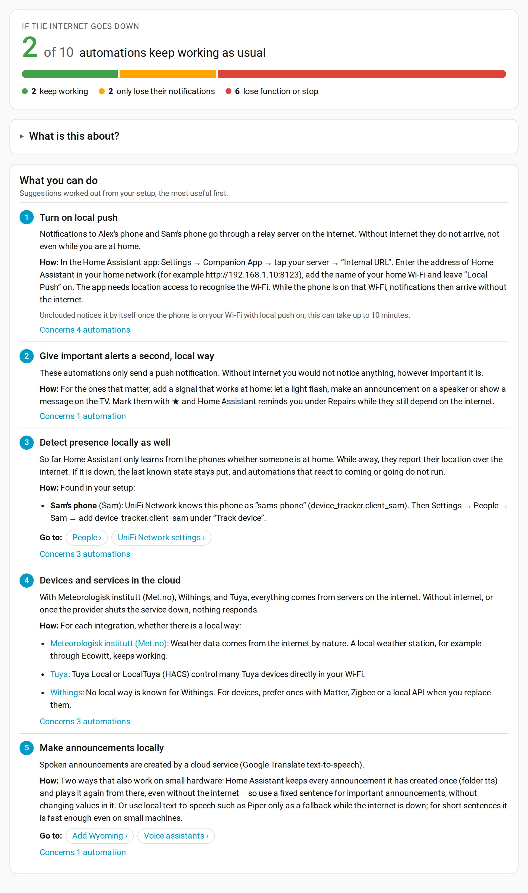
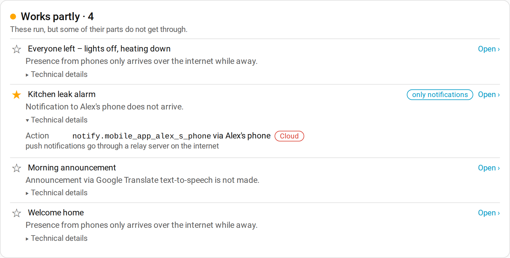

<p align="center"></p>

# Unclouded

**English** · [Deutsch](README.de.md)

<p align="center">
  
  
  <a href="LICENSE"></a>
  
</p>

Unclouded shows what in your Home Assistant still works when the internet is gone, and
what you can do about the rest.

<p align="center"><picture><source media="(prefers-color-scheme: dark)" srcset="docs/screenshots/overview-dark.png"></picture></p>

## Why I built it

My Home Assistant runs at home, so I assumed it would carry on without the internet. When I
actually looked, a lot of it would not. Notifications to my phone went through a relay
server on the internet. Presence came only from the phones. And a reminder to close the
bathroom window read the outside temperature from a weather service with a fallback of
10 °C, so without the internet it would have quietly assumed mild weather every time.

Home Assistant tells you for each integration whether it uses the cloud. It does not tell
you what that means for your automations. That is the gap Unclouded fills.

## What it does

Unclouded goes through every automation, follows scripts, scenes, helpers, persons and
templates down to the integrations behind them, and sorts the automations into keep
working, only lose their notifications, and lose function. Each one gets a short sentence
saying why, like "Notification to Alex's phone does not arrive".

On top of that you get suggestions that fit your setup: turn on local push, give important
alerts a second way that works at home, detect presence through your router as well (it
names the matching router entry for each phone), and which cloud integrations have a local
alternative. Each suggestion links straight to the page where you change it.

It also checks your voice assistant pipelines, warns when an integration needs more of the
internet after an update than before, and lets you star the automations that matter so
they show up under Repairs. A small sensor watches the connection, and after a real outage
the panel shows what actually went away, so you can see how good the estimate was.

Unclouded only reads. It never changes your setup.

## How it works

1. Open **Unclouded** in the sidebar. The top shows how many automations keep working
   without the internet.
2. **What you can do** lists the suggestions, most useful first.
3. Below, every automation is listed by what happens to it. **Technical details** shows
   which trigger, condition or action needs the internet and why.

   <picture><source media="(prefers-color-scheme: dark)" srcset="docs/screenshots/automations-dark.png"></picture>

4. Star the automations that matter. Home Assistant then lists them under
   **Settings → Repairs** while they depend on the internet.

The [guide](docs/guide.md) goes through the panel in detail and explains how Unclouded comes
to its results.

## Installation

Unclouded needs Home Assistant 2026.10 or newer.

**HACS:** in HACS open the menu → **Custom repositories**, add
`https://github.com/Schnuecks/ha-unclouded` with the type **Integration**, then install
**Unclouded** and restart Home Assistant.

**Manually:** copy `custom_components/unclouded` into the `custom_components` folder of
your Home Assistant configuration and restart.

Then add the integration under **Settings → Devices & services → Add integration →
Unclouded**. The panel appears in the sidebar for admins.

## Good to know

It is an estimate, not a test. Unclouded never cuts your internet; it works from how each
integration connects. Some integrations run locally or through the cloud depending on how
they were set up, and Unclouded knows a number of those. If one does not say how it
connects, you can tell Unclouded yourself.

To notice real outages, Unclouded opens a connection to the public DNS servers 1.1.1.1 and
9.9.9.9 on port 53 once a minute and closes it again. Nothing is sent. That is the only
connection it makes.

Entity IDs that a template builds only while the automation runs cannot be followed and are
left out.

If something is classified wrong, please open an issue with the integration and how it is
set up, so it gets fixed for everyone. See [CONTRIBUTING](CONTRIBUTING.md).

## Development

```bash
python -m venv .venv && . .venv/bin/activate
pip install -r requirements-dev.txt
ruff check . && ruff format --check . && pytest
```

See [CONTRIBUTING](CONTRIBUTING.md).

## How it's built

Unclouded is developed with the help of an AI coding assistant. I define the features and
behaviour, review the changes and test them in my own Home Assistant. Nothing is released
without passing the automated checks: the test suite, Home Assistant's hassfest and the
HACS validation.

## Support

Unclouded is free and stays free. If it helps you, you can buy me a coffee on Ko-fi; it
keeps the project going. Thank you!

<p>
  <a href="https://ko-fi.com/schnuecks"></a>
</p>

## Feedback

Bug reports and ideas are welcome as
[GitHub issues](https://github.com/Schnuecks/ha-unclouded/issues). See also
[CONTRIBUTING](CONTRIBUTING.md) and [SECURITY](SECURITY.md).

What changed in each version is listed in the [CHANGELOG](CHANGELOG.md).

**What to expect:** Unclouded is a hobby project that I use in my own Home Assistant. I look
at issues and pull requests as time allows, without a guaranteed response time.

## License

Copyright (c) 2026 Schnuecks. Released under the [MIT License](LICENSE).
